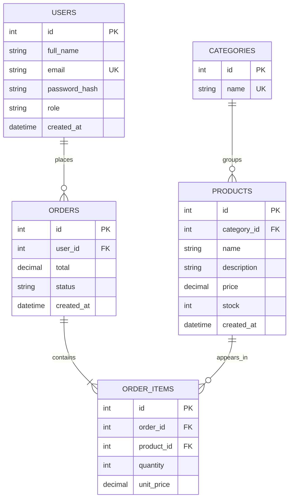

# QuickCart database ERD

## Table purposes
- **users:** account identity, hashed password, and role.
- **categories:** product grouping.
- **products:** catalog details, price, and available stock.
- **orders:** order owner, total, status, and timestamp.
- **order_items:** product, quantity, and price snapshot for each order.
